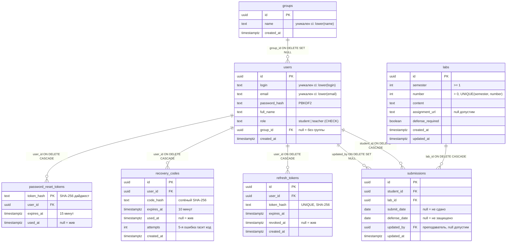

# Сдача лабораторных работ

Приложение для учёта сдачи лабораторных работ: Angular-клиент и бэкенд на
ASP.NET Core, работающие вместе по контракту REST API `/api/v1`. Клиент ходит
в API через `HttpClient` (мок-слой удалён); аутентификация — JWT в
httpOnly-cookie (access 15 мин + refresh 7 дней).

Репозиторий разделён на две части: `src/client` — Angular-приложение
(клиент), `src/api` — бэкенд (ASP.NET Core, .NET 8; подробности — в
[README](src/api/README.md) каталога и в
[спецификации](docs/system-specification.md)).

## Стек

Клиент:

- Angular 20+, standalone-компоненты, TypeScript strict
- SCSS, единственный брейкпоинт проекта — **768px** (граница мобильной вёрстки)
- PrimeNG 20+ с темой Aura (`@primeuix/themes`, только светлый режим) и primeicons
- Русская локаль: `LOCALE_ID = ru`, `registerLocaleData(localeRu)`, русские
  переводы встроенных текстов PrimeNG (`core/config/primeng-ru.ts`)
- Тесты: Karma + Jasmine (ChromeHeadless)

Бэкенд (`src/api`, .NET 8):

- REST API с версионированием в пути `/api/v1`, единый конверт ошибок
  `{message, errors?}`
- Аутентификация: JWT в httpOnly-cookie, PBKDF2-хэширование паролей,
  rate-limiting входа/восстановления
- Хранилище: **PostgreSQL 16** — EF Core (Npgsql) для пользователей, групп,
  работ и токенов; репозиторий сдач — на «сыром» ADO.NET
  (`NpgsqlCommand`/`NpgsqlDataReader`); схема создаётся SQL-скриптами
  [`src/api/db/`](src/api/db/README.md), все репозитории и контроллеры
  асинхронны
- Health-check `GET /health`; Swagger UI — только в Development
- Тесты: xUnit — юнит-тесты (`src/api/LabsApp.Tests`) + интеграционные зоны
  (`tests/integration/B-01…B-23`, HTTP-контракты `/api/v1` через
  WebApplicationFactory; B-23 — сквозные проверки на реальной БД)

## Установка и запуск

Требуется Node.js LTS (20.19+ или 22.12+) и npm, Google Chrome (для
unit-тестов в ChromeHeadless), .NET SDK 8.0, PostgreSQL 16.

### Подготовка базы данных (однократно)

Схема и демо-данные применяются SQL-скриптами из
[`src/api/db/`](src/api/db/README.md):

```bash
psql -h 127.0.0.1 -p 5434 -U labsapp -d labsapp -f src/api/db/02_schema.sql
psql -h 127.0.0.1 -p 5434 -U labsapp -d labsapp -f src/api/db/03_seed_demo.sql
```

### Режим разработки (два процесса)

```bash
dotnet run --project src/api/LabsApp     # бэкенд: http://localhost:5080
npm install                              # зависимости клиента (первый запуск)
npm start                                # клиент: http://localhost:4200
```

`ng serve` проксирует `/api` и `/health` на бэкенд (`src/client/proxy.conf.json`).
Приложение открывается по адресу **http://localhost:4200** (гость попадает на
экран входа; после входа — домашний экран по роли).

### Production-режим (один процесс)

Клиент собирается и раздаётся бэкендом из `wwwroot` (подробности — в
[README](src/api/README.md) каталога `src/api`):

```bash
npm run build
mkdir -p src/api/LabsApp/wwwroot
cp -r dist/asiigments-submit-application/browser/. src/api/LabsApp/wwwroot/
dotnet run --project src/api/LabsApp      # всё вместе: http://localhost:5080
```

Прочие команды клиента:

```bash
npm test           # тесты клиента (Karma + Jasmine, ChromeHeadless):
                   # основной проект + интеграционные TS-зоны B-17/B-18
npm run build      # production-сборка (ng build --configuration production)
npm run watch      # пересборка разработки при изменениях
```

Тесты бэкенда:

```bash
dotnet test src/api/LabsApp.sln                       # юнит-тесты бэкенда
dotnet test tests/integration/B-01                    # одна зона (пример)
# все зоны: tests/integration/B-01…B-22, по одной на батч кейсов
```

## CI/CD (GitHub Actions + Amvera)

Три этапа, каждый — свой воркфлоу в [`.github/workflows/`](.github/workflows/):

| Этап                             | Триггер              | Что происходит                                                                                                         |
| -------------------------------- | -------------------- | ---------------------------------------------------------------------------------------------------------------------- |
| 1. Юнит-тесты (`unit.yml`)       | пуш любой ветки      | Karma-тесты клиента (ChromeHeadless) + xUnit-тесты API (in-memory)                                                     |
| 2. PR в master (`pr-checks.yml`) | pull request         | этап 1 + интеграционные зоны B-01…B-23 (B-23 — на service-контейнере PostgreSQL 16) + зоны клиента B-17/B-18 + линтеры |
| 3. Деплой (`deploy.yml`)         | только ручной запуск | схема БД → push снапшота ветки в git-репозиторий Amvera → сборка и выкат                                               |

Этап 2 — обязательные checks: в настройках репозитория (Settings → Branches →
branch protection для `master`) включить _Require status checks to pass before
merging_ и выбрать статусы `client-unit`, `api-unit`, `integration-zones`,
`integration-b23`, `integration-angular`, `lint-client`, `lint-api` — без них PR
слить нельзя.

Линтеры: клиент — ESLint (angular-eslint + typescript-eslint, включая шаблоны) и
Prettier (`.prettierrc.json`, singleQuote; проверка `npm run format:check`), API —
`dotnet format` по `.editorconfig` (для C# отступ 4). Линтеры охватывают код
приложения (`src/client`, `src/api`); зоны `tests/` — замороженные артефакты
сданных лаб, их проверяют прогоны тестов.

### Деплой: один контейнер в Amvera

Образ собирает Amvera по [`Dockerfile`](Dockerfile) из корня (конфиг —
[`amvera.yml`](amvera.yml)): стадия node собирает клиент → стадия dotnet sdk
публикует API со статикой клиента в `wwwroot` → runtime `aspnet:8.0`, Kestrel
слушает 80-й порт и отдаёт и `/api/v1`, и SPA. Ручной запуск `deploy` пушит
снапшот ветки в `git.amvera.ru` (force-push в отслеживаемую ветку `master`),
Amvera пересобирает и выкатывает контейнер. Перед этим джоба `db-schema`
применяет идемпотентные `02_schema.sql` + `03_seed_demo.sql` к управляемой
PostgreSQL Amvera по внешнему SSL-хосту.

Разовая настройка:

1. В Amvera создать проект «Приложение» (способ загрузки — Git, отслеживаемая
   ветка `master`) и сервис PostgreSQL; для СУБД создать внешнее доменное имя
   (тип POSTGRES).
2. В проекте Amvera задать секрет `Storage__ConnectionString` — подключение к
   СУБД по внутреннему хосту `amvera-<user>-cnpg-<pg-project>-rw` (в Production
   валидатор требует явную строку подключения).
3. В GitHub (Settings → Secrets and variables → Actions) задать секреты для
   `deploy.yml`:

| Секрет               | Значение                                                         |
| -------------------- | ---------------------------------------------------------------- |
| `AMVERA_TOKEN`       | токен аккаунта Amvera (Настройки профиля → Токены)               |
| `AMVERA_USER`        | имя пользователя Amvera                                          |
| `AMVERA_PROJECT`     | имя проекта-приложения в Amvera                                  |
| `AMVERA_PG_HOST`     | внешний хост PostgreSQL (`<project>-<user>.db-msk0.amvera.tech`) |
| `AMVERA_PG_DB`       | имя базы данных                                                  |
| `AMVERA_PG_USER`     | пользователь базы                                                |
| `AMVERA_PG_PASSWORD` | пароль базы                                                      |

4. Запустить воркфлоу `deploy` (Actions → deploy → Run workflow, ветка
   `master`). После сборки приложение доступно на
   `https://<project>-<user>.amvera.io`; здоровье — `GET /health`.

## Демо-учётки и данные

Данные живут в PostgreSQL (применяются скриптами `src/api/db/`, сид приложения
при старте идемпотентен): изменения переживают перезапуск процесса. В
Development «письма» восстановления пароля не отправляются: код выводится в
журнал бэкенда с маркером `[DEV-EMAIL]` (запуск `dotnet run` показывает его в
консоли).

### Демо-учётки

| Логин                   | Пароль        | Роль          | Группа                                             |
| ----------------------- | ------------- | ------------- | -------------------------------------------------- |
| `teacher`               | `teacher123!` | преподаватель | —                                                  |
| `studentNN`, NN = 01…32 | `student123!` | студент       | 01–25 → ИК-221, 26–30 → ИК-222, 31–32 — без группы |

Логин/пароль преподавателя и включение демо-набора настраиваются переменными
`Seed__TeacherLogin`, `Seed__TeacherPassword`, `Seed__DemoData` (полная таблица
переменных — в [README](src/api/README.md) бэкенда).

Остальные данные сида: группы ИК-221/ИК-222/ИК-223 (у ИК-223 студентов нет),
23 лабораторные работы (семестр 1 — №1–20, семестр 2 — №1–3), сид-сдачи.

## Схема данных

Схема PostgreSQL в третьей нормальной форме (3НФ): каждая неключевая колонка
зависит только от ключа своей таблицы, имя группы и семестр сдачи нигде не
дублируются, `studentCount` вычисляется. Скрипты создания и описания —
[`src/api/db/`](src/api/db/README.md).



### Особенности демо-режима

- Тёмная тема фиксированно отключена (`darkModeSelector: false`) — макетами
  предусмотрена только светлая схема.
- В Production переменная `Seed__TeacherPassword` обязательна и не может
  совпадать с демо-значением (guard старта).

## Структура каталогов (NFR-003)

`src` состоит из двух частей: `src/client` — Angular-приложение (клиент),
`src/api` — бэкенд (ASP.NET Core .NET 8).

Внутри `src/client/app` код располагается только в четырёх ветках; иные
отклонения недопустимы. Файлы бутстрапа сознательно разложены по тем же веткам:
маршруты и конфигурация — это «конфиг» (core), корневой компонент — «оболочка»
(layout).

```
src/client/app/core/      — сервисы (HttpClient, /api/v1) и конфигурация
    config/app.config.ts   — провайдеры бутстрапа (роутер, локаль, PrimeNG)
    config/app.routes.ts   — маршруты
    config/primeng-ru.ts   — русские переводы PrimeNG
src/client/app/shared/    — валидаторы, модели, компоненты, переиспользуемые между фичами
src/client/app/layout/    — оболочка приложения и страница 403
    app-root/              — корневой компонент (точка входа бутстрапа)
src/client/app/features/  — фичи: features/<фича>/pages, features/<фича>/components
src/api/                  — бэкенд: ASP.NET Core, REST API /api/v1 (см. src/api/README.md)
src/api/db/               — SQL-скрипты БД: схема 3НФ, индексы, демо-данные
tests/integration/        — интеграционные зоны B-01…B-23 (xUnit + TS-зоны B-17/B-18)
src/client/styles.scss    — глобальные стили
src/client/styles/        — SCSS-примеси: единственный брейкпоинт 768px
```

`src/client/main.ts`, `src/client/index.html` и `src/client/styles.scss` —
стандартные точки входа Angular CLI вне `src/client/app`.
